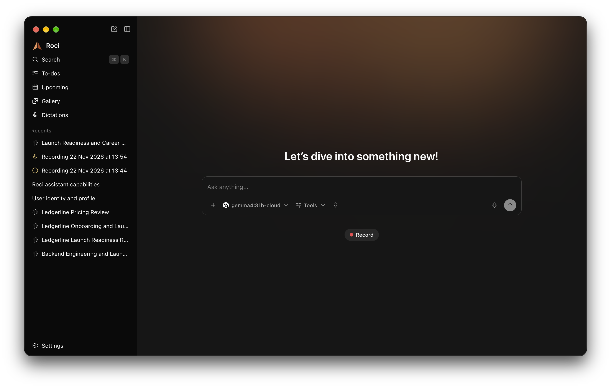
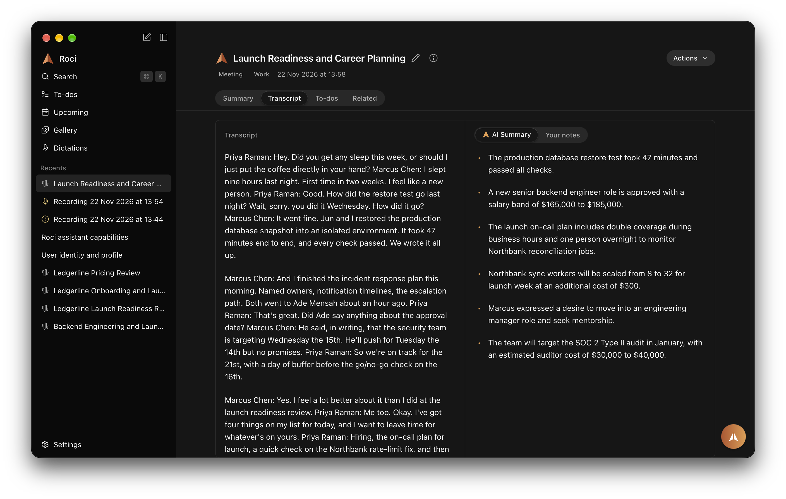
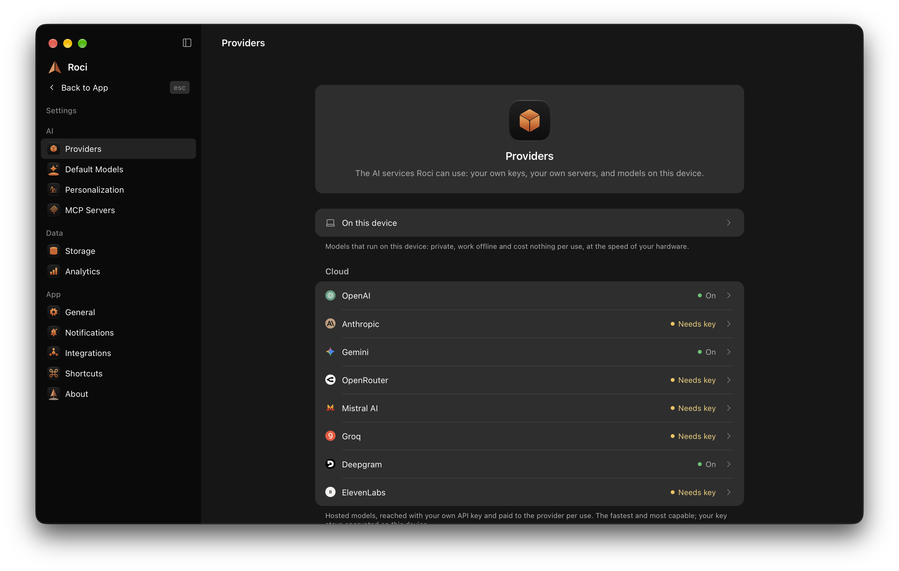

<p align="center">
  
</p>

<h1 align="center">Roci</h1>

<p align="center">Private meeting notes and AI chat for Mac, iPhone and iPad.</p>

<p align="center">
  
  
  
  
  
  
  
  
  
</p>

<p align="center">
  
</p>

## What it does

- **Records meetings.** On Mac, your microphone and the call's audio; on iPhone and iPad, the microphone. The transcript
  appears while you talk: word by word with a model that streams, every few seconds otherwise.
- **Transcribes and summarizes** with the speech and text models you pick: a summary, action items and to-dos, and your
  own notes filled in from what was said. Save a recording for later and summarize it when you want.
- **Dictation** anywhere you type, with the same speech models.
- **Search by meaning.** Ask about anything said in past meetings; answers point back to the meeting and the moment.
  Hybrid search (keywords plus vectors) runs in the app's own database.
- **A knowledge graph that builds up over time.** Each meeting adds the people, organizations, projects and topics it
  discussed, and how they relate, so links between meetings are there when you need them.
- **Tracks what AI costs.** Every call is logged with its tokens or audio minutes and priced from models.dev, or from your
  own price. Usage shows cost by model, by use and over time.
- **Calendar.** Upcoming meetings, a reminder before each one, and a Record button in it.
- **Tools.** Web search, image generation with cloud models, and MCP servers.

<p align="center">
  
</p>

## Models: on the device, on your server, or in the cloud

| Where | What runs there |
|---|---|
| **On this device** | Chat and meeting-search embeddings on [MLX](https://github.com/ml-explore/mlx-swift). Speech recognition with [transcribe.cpp](https://github.com/handy-computer/transcribe.cpp) (Parakeet, Nemotron, Whisper). Read aloud with a voice model or the system voices. Apple Intelligence and Apple Speech. Nothing leaves the device and nothing is charged. |
| **Your own server** | Any OpenAI-compatible server on your network: Ollama, LM Studio, Jan, llama.cpp. |
| **Cloud** | OpenAI, Anthropic, Google Gemini, OpenRouter, Mistral, Groq, Deepgram and ElevenLabs, with your own API key. |

What each model can do (text, images, audio in and out) and its price come from [models.dev](https://models.dev), with a
small built-in list for models it doesn't cover yet.

<p align="center">
  
</p>

## Privacy

There is no account, no Roci server and no sync. Meetings, chats, recordings and settings are kept in one SQLite database
on your device; API keys are encrypted in it with a key held in the macOS Keychain. Audio and text go only to the models you
choose.

## What it doesn't do

- It doesn't join calls as a bot. It records on your device.
- On iPhone and iPad it records the microphone only.
- Mac only: menu bar, call detection, call audio, Spotlight, Apple Notes, local servers and local MCP servers.

## Built with

Tauri 2 (Rust core, native macOS audio capture through Core Audio taps), React 19 and TypeScript, the Vercel AI SDK for
every model call, Zustand and TanStack Query for state, Tailwind and Radix for the interface, SQLite with sqlite-vec and
GraphQLite for search and the graph, and Swift plugins for Apple Intelligence, calendar, notifications and Spotlight.

Portions of the code are ported from [Jan](https://github.com/janhq/jan) and [Hex](https://github.com/anomalyco/hex),
under their licences (see [THIRD_PARTY_NOTICES.md](THIRD_PARTY_NOTICES.md)).

## Requirements

- macOS 26, iOS 26 or iPadOS 26, on Apple silicon.
- To build: Xcode 26 with its Metal Toolchain, Rust, and Node.js 22.

## Build from source

```bash
git clone https://github.com/pareekshithbompally/roci.git
cd roci
npm install
npm run tauri:dev      # run on Mac
npm run tauri:build    # build the Mac app
npm test               # run the tests
```

## Contributing

Roci is a personal project shared as-is. I can't take on issues or pull requests, but you're welcome to fork it.

## License

MIT. See [LICENSE](LICENSE) and [THIRD_PARTY_NOTICES.md](THIRD_PARTY_NOTICES.md).
